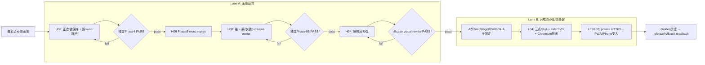

# MinimalizerLocal 実装設計図（2026-11-09 再整理）

**現行main:** `d60563a37e0f8645484b51f88d103220e6e13712`  
**目的:** Aの実画像品質を確定し、既に完成したBのprivate配信基盤で
同じ成果物を安全に届ける。  
**禁止:** BがAの衣装・腕・髪・owner・画質を修復または承認しない。Aが
private HTTPS/PWA/SWの実装を変更しない。

## 1. 役割を一文で固定する

| Lane | 役割 | 完了の意味 |
| --- | --- | --- |
| **A — 画像品質** | 署名済み原画像から、正しい衣装・腕・髪・遮蔽・exclusive ownerを作る | 独立Phase4/5と人間の画質判定がPASS |
| **B — 表示・配信** | Aが固定したStage8/SVGを壊さず、安全にprivate HTTPS/PWA/iPhoneへ届ける | 三点連携・SVG表示・PNG保存・障害復旧がPASS |

Bは実装完了である。Aの成果物が新しいSHAになった時だけ、Bは**同じ
delivery auditを再実行する**。これはBの再開発ではなく、最終成果物への
受入確認である。

## 2. 現在地

| 項目 | 状態 | 根拠 |
| --- | --- | --- |
| B L04 | **COMPLETE** | 三点SHA連携、安全SVG、実Chromium描画。main `d60563a` |
| B L05 | **COMPLETE** | private HTTPSのPNG、415/429/503、fallback、PC/iPhone receipt |
| B L07 | **COMPLETE** | generation-pinned SW、Safari/PWA、機内モード往復、iPhone receipt |
| A H06 | **NEXT** | 正衣装を保護したまま腕・下着の誤ownerを除去 |
| A H08 | HOLD | 袖回復、腕・衣装のexclusive owner、Phase4 FAILを修復 |
| A H04 | HOLD | 誤検出の修復 |
| Golden / release | HOLD | A全caseの独立品質PASS後にだけ開始 |

`1887`等の頂点cap、Aの見た目、owner、silhouetteはAの品質・方針領域で
あり、B L04の表示PASSを否定しない。Bは値を測定・記録するが、勝手に
変更もしない。

## 3. 完成までの一本道

## 4. Aの各工程で変えてよいもの・変えてはいけないもの

| 工程 | 最小変更 | 必須検証 | 禁止 |
| --- | --- | --- | --- |
| H06 | source-only推論・owner割当の一点修正 | 正衣装保持、腕/下着誤owner除去、unknown維持、RGB/alpha/SHA、4/8連結・holes・遮蔽 | 人手ラベルの推論入力、class11一律保護、既知例への閾値合わせ |
| H08 | 袖・腕/衣装境界のsource-only修正 | exclusive owner、袖回復、保護部位、Phase4を独立評価 | H06の結果をH08へ横流し、Phase5でPhase4 FAILを隠す |
| H04 | 明示された誤検出だけを最小除去 | 既存の正しいowner/構造が回帰しないこと | まとめて再分類、Goldenの書換え |

各caseは `Goal → Produce → Verify → Review → Ship → Preserve → Next` の順。
Phase4が独立PASSするまで、Phase5やBへの正式受渡しをしない。

## 5. AからBへの受渡し契約

final候補ごとに、Aはprivate Driveへ次だけを固定する。

1. 署名済み元画像（source SHA、RGB/alpha来歴）
2. Aが確定したStage8 JSON（producer/config/commit SHAを含む）
3. 同じStage8から展開したSVG

Bはその三点を変更せず、以下だけを記録する。

- 三点のSHAとStage8内cross-link
- SVGの安全性（外部参照・script・raster埋込の拒否）
- 実Chromiumでのprivate PNG描画
- private HTTPS/PWA/iPhoneの保存・復帰・fallback表示

GitHubにはsource-free code、test、集計、receipt SHAだけを置く。原画、
mask、NPZ、SVG座標、比較PNG、端末画面はprivate Driveだけに置く。

## 6. 現在の作業キュー

1. **H06** のfirst-bad-stageを固定し、正衣装を失わない最小source-only
   修正を実装・独立評価する。
2. H06がPhase4/5を通った場合だけ、**H08** の袖/腕/衣装exclusive ownerへ進む。
3. H08後に **H04** の誤検出を修復する。
4. Aのfinal SHAが固定されたら、Bの既存L04 delivery auditを一回実行し、
   既存L05/L07の本番受入へ接続する。
5. 全caseのA visual review後、Golden承認とrelease/rollback readbackを行う。

## 7. 履歴の扱い

- PR #456はA領域へ踏み込んだsource-preserving研究。**Draftのまま
  mergeしない**。
- PR #449はAの研究候補。品質PASSが得られるまでDraft/NO_GOを維持する。
- Bの完了recordはmain `d60563a`。L04/L05/L07を再設計しない。

この設計図は、完了済みBを再びボトルネックにしないための現行正本である。
