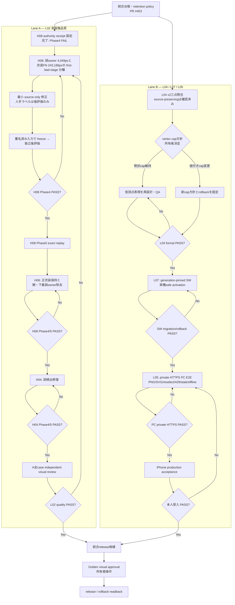

# MinimalizerLocal 統合コントロールブック（2026-11-09）

Status: **運用・整理の正本。品質承認、release 承認、A/B の merge 指示ではない。**

## 1. この文書の役割

MinimalizerLocal は二本の独立した開発線を持つ。

- **Lane A / L02**: H06 の正衣装保持と誤 owner 除去、H08 の袖回復と腕・衣装の排他的 owner、H04 の誤検出。
- **Lane B / L04/L07/L05**: Stage8-SVG 三点照合、Service Worker 世代移行、private HTTPS の PC/iPhone 統合受入。

本書は、この二線を一つの完成工程として管理するための唯一の現行台帳である。コード、品質ゲート、レビュー、merge は引き続き各 lane で独立する。古い handoff・研究メモ・実験 ZIP は履歴として残すが、次の作業を決める正本にはしない。

## 2. 2026-11-09 の確定スナップショット

| 対象 | 現行参照 | 状態 | 扱い |
| --- | --- | --- | --- |
| GitHub main | `d7caae3bc9500a63c021e7cc51594a7f8084c7cc` | handoff #450 を含む | 本書の base。実装開始前に再読取する。 |
| Lane A | PR #449, `research/local-l02-class32-topology-palette-shadow-20261102`, `a10677abaae804c86fb43bd9e8a8957219aaf394` | Draft / 未 merge | A だけの研究候補。main へ混入させない。 |
| Lane B | PR #451, `codex/l07-generation-pinned-20261107`, `c593b46c53c28127b08d74d2ce733045495b5577` | Draft / 未 merge | L07 と L04/L05 の source-free 実装候補。main へ混入させない。 |
| A private evidence | Drive `chatGPT及びCodex用/Minimalizer` と所有 PC の private work areas | 保持中 | 署名済み原画像、mask、NPZ、座標、比較板は GitHub 非掲載。 |
| B private evidence | 同 Drive と所有 PC の runtime receipts | 保持中 | signed original、Stage8 JSON、展開 SVG、private HTTPS 実機 receipt は GitHub 非掲載。 |

## 3. 旧状態票の矛盾を解く規則

2026-11-07 の compact JSON には `independent_blind_holdout=NOT_VERIFIED`、`owner_authority=NOT_GRANTED`、license 関連の未解決が残る。しかし、その後の所有者確認で次は確定した。

1. H06/H08 の評価データは未見である。
2. 推論前に人手ラベルを入力していない。
3. 評価者は開発側から独立している。
4. 腕・下着・遮蔽・正衣装保持の意味評価は済んでいる。
5. license evidence を L02 の gate として要求しない。

したがって compact JSON は**当時の transfer receipt**として保存し、現在の gate 状態を決める資料から外す。消去・書換えはしない。次の A receipt は上記五点を明記し、旧 schema の値を引き継がない。

ただし、H08 の最終 owner-authority receipt はまだ作成・読戻しが必要である。これは license gate ではなく、どの frozen inference output を誰が Phase4 判定対象として認可したかを固定する作業である。

現時点で混同してはいけない候補は二つある。

- 新規 source-only SegFormer 推論の H08 prediction SHA は `8e3613bf90202a5a04a58f53b7ba66e755a601494e37fac1a5137ad06bcf4275`。これは衣装 prediction であり、owner promotion ではない。
- 既存 H08 owner-promotion replay は frozen owner SHA `43d164d934614fce104f5cd3da1519e95571d81c287c107b99cdf53db2766c52` を入力に 591px を候補割当した historical candidate で、receipt 自身が `owner_promotion_authorized=false` と記録している。
- 独立評価 package の `H08_OWNER_4_PRIVATE.npz` は SHA `0a352e424c993deac3494c1b9fbf8716fb4cfd7fe78fa688f197eadc0c3607be` だが、現時点の source-free receipt には producer/config と Phase4 candidate への来歴結合がない。これを authority receipt の対象に選ばない。

よって receipt 作成の最初の操作は、Phase4 判定対象にする **owner map の byte SHA と producer/config SHA を一組だけ選ぶこと**である。prediction の評価結果を owner-authority と取り違えない。

選定済みの対象と認可範囲は [H08 owner-authority receipt](../handoffs/HND-20261109-MINIMALIZER-LOCAL-H08-OWNER-AUTHORITY-RECEIPT.md) に固定する。

## 4. 現行ゲートと一本道

### A: L02 / Phase4

1. **H08 owner-authority receipt** は対象固定とmaterialized replayまで完了したが、Phase4は FAIL である。次のH08作業は固定candidateをbaselineに、残存誤ownerと衣装FNの最初の失敗点を分離する。人手マスクは後評価専用であり、推論入力にしない。
2. H06/H08/H04 を同じ Phase4 contract で再判定する。RGB/alpha、source SHA、exclusive owner、4/8 連結、holes、critical parts、occlusion、正衣装保持、誤 owner 除去、unknown 分離を記録する。
3. Phase4 が独立して PASS した case だけ Phase5 exact replay へ進める。Phase5 の PASS を Phase4 の代用にしない。
4. A の全対象が Phase4/Phase5 と visual review を満たすまで L02=HOLD、Golden=HOLD、production=NO_GO を維持する。

### B: L04 / L07 / L05

1. **L04** は signed original / formal Stage8 JSON / expanded SVG の三点 SHA を固定する。現行 v2 は三点照合と source-preserving 判定を保持するが、H06 `72201`、H08 `56249` vertices は legacy `1887` cap と整合しない。cap を引き上げるか別表現へ戻すかは、履歴 FAIL を残す版付き owner 方針が必要で、勝手に進めない。
2. **L07** は generation-pinned SW の source QA を維持し、production activation 前に deferred activation、旧世代保持、asset 欠損 fail-closed、API/image 非 cache、rollback を確認する。
3. **L05** は実際の private HTTPS で PC の input/preview/PNG/SVG/save/reselect SHA、429 + `Retry-After`、stale、cold/warm、offline を確認し、その production 反映後に iPhone 受入へ進む。

### 横断順序

`台帳固定 → A receipt 整備 → A Phase4 → A Phase5 → B L04 方針決定 → B L07 production-safe activation → B L05 PC private HTTPS → iPhone acceptance → Golden/release`

L04 の vertex 方針決定や iPhone/Golen の受入だけは所有者判断が要る。それ以外の source-free 整理、receipt 生成、限定テスト、read-only 照合は継続実行する。

## 5. 保管区分

### A. 必ず保持する（canonical evidence）

- signed original の bytes と source SHA-256、alpha/RGB 来歴。
- frozen inference input/config/code/output SHA、Stage8 JSON、expanded SVG。
- 独立評価 receipt、H08 owner-authority receipt、評価の unknown 区分。
- A/B の現行 branch/PR head、main handoff、merge 前 source-free tests と metrics。
- LocalWorker/private HTTPS の runtime receipt、HTTP headers、PNG/SVG output、reselect SHA、障害系 receipt。
- 所有者が確定した gate 変更・cap 方針・Golden/iPhone 受入。

保存先: private evidence は承認済み Drive、source-free code/test/metrics/control book は GitHub。

### B. 保持するが active evidence から外す（archive/reference）

- 旧 Run、旧 ZIP、旧 source-free research report、棄却候補、旧 branch checkpoint。
- 同じ問いに対する旧 version の Stage8/SVG bundle。
- 限定既知例でのみ得た可視比較、過去の screenshot、補助ログ。

これらは `historical` と明示し、現行 gate を満たす根拠として引用しない。削除せず、manifest から現行 canonical evidence への逆参照を作る。

### C. 将来の整理候補（所有者承認が必要）

- SHA-256 が完全一致し、Drive とローカル双方で読戻し済みの重複コピー。
- 固有 receipt を含まない一時展開物、cache、再生成可能な中間出力。
- 同一バイトの複数 ZIP のうち、canonical manifest に採用されなかったもの。

この区分は削除指示ではない。移動・削除前に対象一覧、byte SHA、復元元、rollback を提示して承認を得る。

## 6. ローカル/GitHub 差分の修復規則

1. private raw、mask、NPZ、座標、比較画像、runtime credential は GitHub へコピーしない。
2. GitHub に必要なのは source-free code/test/doc/aggregate metric だけ。private で検証した事実は SHA・artifact kind・gate outcome に抽象化する。
3. A/B branch は相互に cherry-pick しない。共通化が必要なら main から新しい最小 PR を切り、両 lane の gate を満たす独立コードとして扱う。
4. 実運用 LocalWorker と checkout の差は、path、HEAD、起動 command、`/health`、CORS、generation を読取りで台帳化してから、必要最小の同期 PR に分ける。
5. 「古い文書が残っている」こと自体は不具合ではない。古い文書を現行正本から外す index を優先し、履歴本文を改竄しない。

## 7. 実行時の一行ルール

- 毎回、main/A/B HEAD と対象 private artifact の SHA を先に記録する。
- 一工程は一つの具体的 defect または receipt に限定する。
- PASS はその gate にだけ適用し、品質・production・iPhone へ横流ししない。
- 新しい結果が古い状態票と矛盾したら、古い状態票を削除せず `superseded-for-current-gate` と台帳に記録する。
- Public/C08、production LocalWorker、Golden、signed originals はこの整理工程から変更しない。

## 8. この整理工程の完了条件

1. 本書の各現行参照が GitHub/Drive/ローカルで読戻し可能である。
2. A/B の active gate、履歴、必須保持物、整理候補が区分済みである。
3. A の次は H08の残存誤owner/FNのfirst-bad-stage分離、B の次は L04 vertex-policy owner decision と明確である。
4. 未承認の削除、branch merge、production 変更を行っていない。

## 9. 完成までの全工程図

### 工程一覧と完了条件

| 順 | lane | 工程 | 現在地 | 次へ進む条件 |
| ---: | --- | --- | --- | --- |
| 0 | 共通 | 台帳・保存区分・現行SHAの固定 | 完了 | PR #453を正本として更新可能にする。 |
| 1 | A | H08 Phase4 receipt | 完了、FAIL | 固定candidateの残存誤owner/FNをfirst-bad-stageへ帰属する。 |
| 2 | A | H08最小修正と独立Phase4 | 未着手 | 正衣装・腕/下着・遮蔽・exclusive owner・4/8・holes・critical partsを同時にPASS。 |
| 3 | A | H08 Phase5 exact replay | 未着手 | H08 Phase4単独PASS。 |
| 4 | A | H06 修正とPhase4/5 | 未着手 | 正衣装を失わず誤ownerを除去し、unknownを陰性化しない。 |
| 5 | A | H04 修正とPhase4/5 | 未着手 | 誤検出を除去し、Aの既存PASSを回帰させない。 |
| 6 | A | L02全case visual review | 未着手 | H04/H06/H08すべての独立評価とvisual reviewがPASS。 |
| 7 | B | L04 vertex方針 | **所有者判断待ち** | `1887`維持か、版付き新cap/rollbackかを決定。 |
| 8 | B | L04 formal三点gate | HOLD | signed original・Stage8 JSON・SVG・budgetを同じ方針でPASS。 |
| 9 | B | L07実機safe migration | HOLD | 世代固定、deferred activation、rollback、非cache境界を実機でPASS。 |
| 10 | B | L05 PC private HTTPS | HOLD | actual input/output、PNG/SVG、reselect SHA、429/stale/offline/cold-warmをPASS。 |
| 11 | B | iPhone受入 | 未着手 | 本番反映後、本人が実機で受入。 |
| 12 | 統合 | Golden / release | **所有者操作** | A品質、B運用、iPhone受入がすべてPASSし、Golden目視承認を得る。 |

### 並行できる範囲

- AのH08/H06/H04は、前caseがFAILならそのcase内でのみ修正する。別caseへ品質PASSを横流ししない。
- BはAの具体的な修正待ち中、L04のread-only三点QA、L07 source QA、L05 receipt整備を独立して進められる。
- L04 vertex cap方針、iPhone受入、Goldenは所有者判断まで進めない。その他は具体的FAILの修正として継続する。
